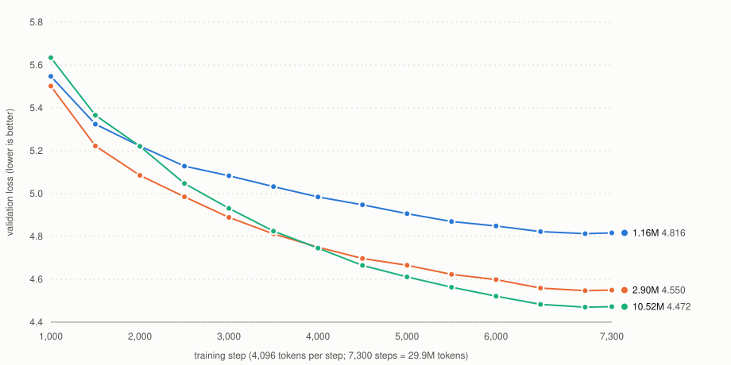

# AsemLLM Stage 1: three model sizes, one corpus (Common Lisp, CPU only)

Controlled comparison of 1.16M, 2.90M and 10.52M parameter transformers trained from scratch with this repository's Common Lisp engine (FP32, Apple Accelerate for matrix products) on a single M1 Pro CPU. Same corpus, BPE tokenizer, splits, seed, schedule shape and token budget (29.9M tokens); only the size and the validation-selected learning rate differ.

**Headline.** Language modeling improves with size on both the validation and the held-out test split. None of the three models answers questions better than chance, and none uses the content of the question to choose the answer.



Interactive version with a table view: [`results/stage1/validation-loss.html`](results/stage1/validation-loss.html). Loss is on 128 fixed validation windows, every 500 steps.

## Results

| | 1.16M (lr 0.01) | 2.90M (lr 0.003) | 10.52M (lr 0.003) |
|---|---|---|---|
| Parameters | 1,155,392 | 2,901,120 | 10,522,880 |
| Full-validation loss (perplexity) | 4.820 (123.9) | 4.554 (95.0) | 4.469 (87.3) |
| Test loss (perplexity), read once | 4.722 (112.4) | 4.475 (87.8) | 4.392 (80.8) |
| Train loss at the end | 4.604 | 4.313 | 4.196 |
| Question accuracy (90 questions) | 28.9% (26) | 28.9% (26) | 25.6% (23) |
| Calibrated accuracy | 30.0% (27) | 30.0% (27) | 34.4% (31) |
| Without the question | 28.9% | 27.8% | 21.1% |
| With a mismatched question | 25.9% | 27.0% | 24.1% |
| Margin gain z (summed / mean) | -0.3 / +1.0 | +0.3 / +1.3 | -0.6 / +0.3 |
| Answer-probability change z | +4.3 | +6.3 | +6.1 |
| Training time | 14.6 min | 25.0 min | 76.3 min |
| Throughput | 34,224 tokens/s | 19,915 tokens/s | 6,531 tokens/s |
| Peak memory | 702 MB | 809 MB | 1,336 MB |

Chance is 25%. For 90 questions the 95% band for guessing runs up to 33.9%, and one standard error is about 4.6 points.

### Validation loss at identical token counts (sampled windows)

| Step | Tokens | 1.16M | 2.90M | 10.52M |
|---|---|---|---|---|
| 0 | 0.0M | 9.166 | 9.113 | 9.134 |
| 1000 | 4.1M | 5.547 | 5.502 | 5.634 |
| 2000 | 8.2M | 5.222 | 5.085 | 5.221 |
| 3000 | 12.3M | 5.083 | 4.889 | 4.931 |
| 4000 | 16.4M | 4.984 | 4.750 | 4.746 |
| 5000 | 20.5M | 4.906 | 4.666 | 4.611 |
| 6000 | 24.6M | 4.849 | 4.598 | 4.521 |
| 7000 | 28.7M | 4.813 | 4.547 | 4.470 |
| 7300 | 29.9M | 4.816 | 4.550 | 4.472 |

The 10.52M model trails the 2.90M model early (it has fewer tokens per parameter), ties it at step 4,000 and leads from step 4,500 on, finishing 0.085 nats ahead on the full validation split and 0.083 on the test split.

## What the question results do and do not show

- All three accuracies sit inside the chance band. The apparent drop for 10.52M (23 of 90 against 26 of 90) is a three-question difference and is not evidence of anything.
- Removing the question, or replacing it with another item's, barely changes the scores. The models react to the *kind* of question (answer-probability change z of +4 to +6, which a model can get from knowing whether answers are numbers or names) but the correct answer does not gain on the wrong ones when its own question is present (margin gain z near zero; the flag threshold is 3).
- 10.52M's calibrated accuracy of 34.4% (31 of 90) is 0.5 points above the 95% chance band. With four accuracy variants and three models, one value at the edge is expected by chance, and its margin gain is about zero. Treat it as a lead for a larger evaluation set, not a result.
- The longest evaluation item is 51 tokens against a 128-token context, so context length is not what limits these scores.

## Setup

- **Corpus.** FineWeb-Edu `sample/10BT` shards `000_00000` and `001_00000` (read through HTTP range requests by `lisp/bin/fetch-fineweb.lisp`, no Python), filtered to score >= 4.0 and language_score >= 0.95: 9,175 documents from 1,251,000 rows read (0.73%%). After the builder's filters and exact and near-duplicate removal: 9,077 documents. Split by document hash into train 8,893 documents / 11,088,164 tokens, validation 89 / 125,724, test 95 / 108,296 (about 98/1/1). 8,192-token byte-level BPE trained on the training split only.
- **Dataset version** `e8c6745b968d9efc` (`lisp/bin/build-data.lisp verify` passes); fetched JSONL SHA-256 prefix `3cc802d79369c708`; tokenizer SHA-256 prefix `30d876e0d13bf800`. Settings used: min edu score 4.0, validation 10 permille, test 10 permille. (The manifest wrote each setting twice, override then shadowed default, so a last-wins JSON reader sees the wrong values. Fixed in the data builder after this build; the stage1 manifest still verifies, and the first entry of each key is the value used.)
- **Evaluation set.** `lisp/eval/asem_eval.jsonl`, 90 four-option questions (30 facts, 30 reading comprehension with the passage in the prompt, 30 basic reasoning), answers balanced over positions, SHA-256 prefix `53a116a2a4da4175`. Exact-string contamination check against the corpus: 0 of 120 strings (one question was reworded after a generic-sentence match). Authored by the assistant, not taken from a public benchmark.
- **Model.** Decoder-only transformer, pre-RMSNorm, ReLU MLP, learned positions, context 128, 8,192 vocabulary, untied embedding and output matrices. 1.16M: dim 64, 2 layers, 4 heads. 2.90M: dim 128, 4 layers, 4 heads. 10.52M: dim 256, 8 layers, 8 heads.
- **Training.** 7,300 steps of 32 sequences x 128 tokens (29.9M tokens, about 2.7 passes over the training split), Adam (0.9, 0.95), 200 warmup steps then cosine decay to 10%%, gradient clipping at 1.0, seed 1, 8 worker threads, FP32 with Accelerate (`TLM_BLAS=1`). Best checkpoint chosen on the sampled validation loss; the test split was read once per final model, by `evaluate.lisp`. Each run's stability was checked first with a 600-step probe (`check-stability.lisp`), all passed.
- **Learning rate.** Chosen per size by validation loss after 800 steps over {0.001, 0.003, 0.01}, with 0.02 and 0.03 added for 1.16M because its best value sat at the edge:

| lr | 0.001 | 0.003 | 0.01 | 0.02 | 0.03 |
|---|---|---|---|---|---|
| 1.16M | 6.341 | 5.926 | 5.772 | 5.790 | 5.826 |
| 2.90M | 6.155 | 5.812 | 5.879 | n/a | n/a |
| 10.52M | 5.960 | 5.862 | 6.204 | n/a | n/a |

  For 1.16M the full-length check agrees: lr 0.01 gave full-validation loss 4.820 against 4.910 for lr 0.003 over all 7,300 steps.

- **Machine.** Apple M1 Pro (10 cores, 16 GB), SBCL 2.6.10, AC power. Throughput figures come from runs the machine did not sleep during (an earlier run's slowdown was traced to lid-closed sleep).

## References

| | Best checkpoint (not in git) | SHA-256 prefix | Size |
|---|---|---|---|
| 1.16M | `data/runs/final/1m/best.ckpt` | `f3222fafafc7a9de` | 4.6 MB |
| 2.90M | `data/runs/final/3m/best.ckpt` | `8bb4ec5d0a2b58db` | 11.6 MB |
| 10.52M | `data/runs/final/10m/best.ckpt` | `10e6e08e165de4bc` | 42.1 MB |

Intermediate checkpoints every 1,000 steps are in the same directories. Raw logs (loss, gradient norm and learning rate every 50 steps, evaluations every 500), `eval.json` and `diagnosis.json` for each model, the learning-rate search and the run summary are in [`results/stage1/runs/`](results/stage1/runs/). Code at commit `bf0c143` on branch `fp32-training`.

## Reproduce

```sh
sbcl --dynamic-space-size 4GB --script lisp/bin/fetch-fineweb.lisp data/fineweb/stage1.jsonl max-tokens=10000000 \
     shards=sample/10BT/000_00000.parquet,sample/10BT/001_00000.parquet
sbcl --dynamic-space-size 8GB --script lisp/bin/build-data.lisp build data/fineweb/stage1.jsonl data/fineweb/stage1 8192 100000 4.0 10 10
sbcl --dynamic-space-size 4GB --script lisp/bin/check-contamination.lisp lisp/eval/asem_eval.jsonl data/fineweb/stage1.jsonl
lisp/bin/lr-search.sh data/fineweb/stage1 data/runs/lrsearch "1m 3m 10m" "0.001 0.003 0.01"
lisp/bin/final-comparison.sh data/fineweb/stage1 data/runs/final "1m:0.01 3m:0.003 10m:0.003"
```

The same seed and data give byte-identical checkpoints with one worker (tested); with 8 workers the order of floating-point sums can differ between machines.

## Limitations

- One seed per size, one corpus, one evaluation set of 90 questions that is easy and small: differences of a few points are noise.
- The learning-rate search used 800 steps; the 1.16M check over the full length agreed, the others were not re-checked.
- Sampled validation loss (128 windows) was used to pick checkpoints; the reported numbers are over the whole splits.
- Validation and test are about 1% each of the corpus (about 125k and 108k tokens).
- 10.52M parameters on 11M unique tokens (about 1 unique token per parameter) is far below compute-optimal data per parameter, so the size comparison is as much about data as about capacity.
- No comparison with other CPU training systems has been run, and no public benchmark (such as HellaSwag) has been run on these models.

## Next

A larger independent question set (hundreds of items, generated with held-out entities and templates, plus one public benchmark), more unique pretraining tokens, and then a controlled supervised fine-tuning experiment with a no-fine-tuning control and a shuffled-answer control.
