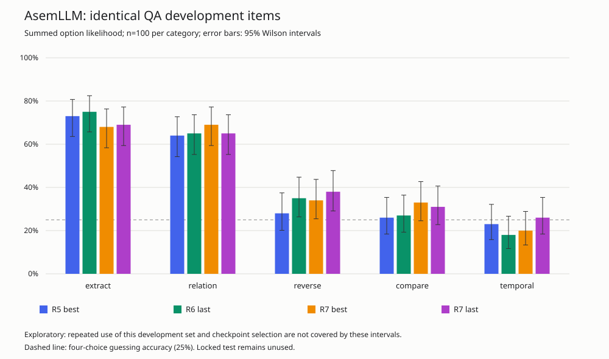
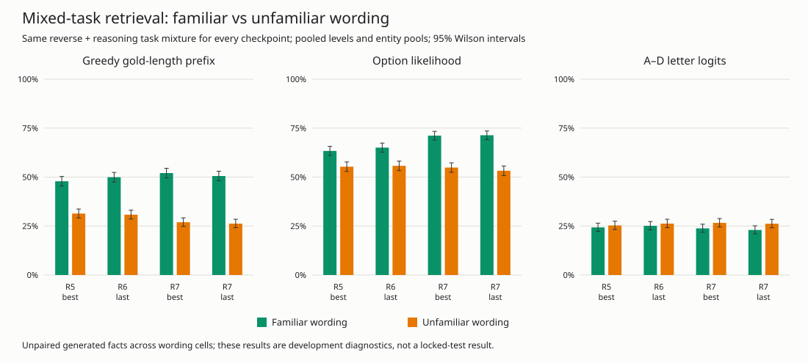
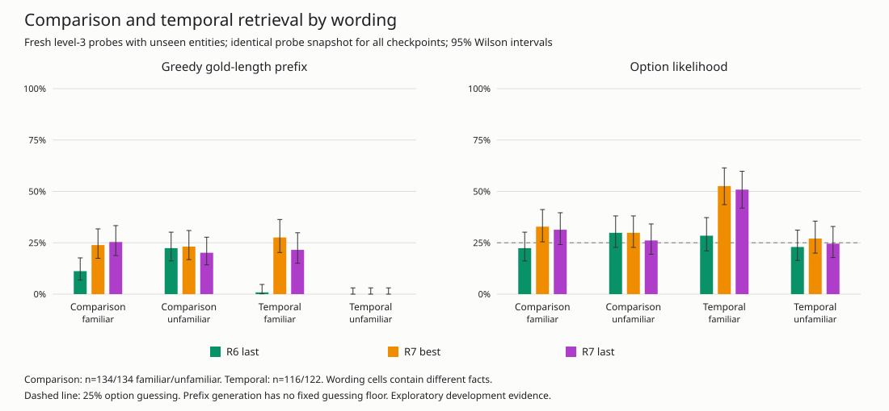

# R7 takeover analysis and controlled weighting pilot

All results here are development evidence. The locked 1,000-question test was not evaluated, and the 90% raw-accuracy objective has not been reached. The Common Lisp/SBCL/Accelerate training engine is preserved.

## What R7 established

The existing 500-item QA benchmark is identical across R5, R6 and R7: SHA-256 `2d92c8825ca3752bd780ecd25023ae5f0a8dcc60677ee6484d46aa95e701032a`. Its entities and original question frames are held out from training. These 500 questions have already influenced several development decisions; they are not a fresh test of the new hypothesis.

| Summed option likelihood | R5 | R6 | R7 probe-best | R7 final |
|---|---:|---:|---:|---:|
| Correct / 500 | 214 | 220 | 224 | 229 |
| Accuracy | 42.8% | 44.0% | 44.8% | 45.8% |
| Extraction / 100 | 73 | 75 | 68 | 69 |
| Relationship / 100 | 64 | 65 | 69 | 65 |
| Reverse lookup / 100 | 28 | 35 | 34 | 38 |
| Comparison / 100 | 26 | 27 | 33 | 31 |
| Temporal order / 100 | 23 | 18 | 20 | 26 |

R7 final gains nine answers over R6, with extraction down six, relationships unchanged, reverse lookup up three, comparison up four and temporal up eight. Its 95% Wilson accuracy interval is approximately [41.5%, 50.2%]. Comparison and temporal intervals still include 25%; these results do not demonstrate reliable general reasoning.

On the paired items, R7 final gains 61 answers and loses 52 versus R6: exact two-sided McNemar p=0.452. Best versus final gains 26 and loses 21, p=0.560. The nine-question gain and five-question checkpoint difference are not distinguishable from paired noise here. All p-values are exploratory and unadjusted for repeated development decisions, multiple categories and checkpoint comparisons.



R7's training-selection probe preferred step 2,000 (152/300) over final step 2,500 (138/300). Independent QA favors the final checkpoint by five answers, while the broader unfamiliar-wording retrieval suite slightly favors the probe-best checkpoint. Neither is uniformly stronger. Both original checkpoints remain preserved; no selection rests solely on the training probe. R5 best/final and R6 best/final have identical model configurations and tensor bytes, so evaluating one member of each pair covers both models. File hashes differ because checkpoint metadata differs. Full hashes and equivalence evidence are in [checkpoints.json](results/stage2/r7-analysis/checkpoints.json).

The complete [R7 training log](results/stage2/retrieval/runs/r7-L123-aug-opts-rev-rsn.jsonl) is archived beside the earlier runs.

## Familiar versus unfamiliar retrieval

The existing retrieval suite was rerun identically for R5, R6 and both R7 checkpoints, with `options=1 reverse=1 reasoning=1 n=200`. It includes levels 1–4, QA-dev and new generated entity pools, and familiar/unfamiliar wording: 3,200 examples per checkpoint. The reasoning and reverse flags are necessary; their defaults omit those tasks.

| Model | Gold-length prefix, familiar / unfamiliar | Summed likelihood, familiar / unfamiliar |
|---|---:|---:|
| R5 | 47.88 / 31.38% | 63.38 / 55.31% |
| R6 | 49.94 / 30.81% | 65.06 / 55.75% |
| R7 probe-best | 52.06 / 26.94% | 71.19 / 54.88% |
| R7 final | 50.56 / 26.25% | 71.38 / 53.25% |

Each column pools eight cells, 1,600 examples. R7 improves familiar patterns but regresses on unfamiliar wording. This supports a template-transfer bottleneck and task interference; it does not establish a single cause. These suite cells use different seeds and change passage and question wording together, so they are not a paired causal estimate of wording. They also contain a different task mix from historical R5 suites that omitted reverse/reasoning.

The new QA diagnostics separately rephrase only each question using the first applicable training frame. Passage, options, facts, entity identities and answer keys remain identical. The counterfactual is rephrased from its own structured query. All 500 real and counterfactual variants fit the 128-token context; none is truncated or rejected. Familiar questions therefore still accompany unfamiliar passage wording. This distinction matters when interpreting residual failures.



### Did comparison and temporal reasoning transfer?

A separate saved probe snapshot tests level 3 with new entities, 600 items per wording cell and identical items across R6/R7. The sampler yields 134 comparison items in each cell, 116 familiar temporal items and 122 unfamiliar temporal items. These are gold-length exact-prefix counts, not four-choice accuracy:

| Task / wording | R6 final | R7 probe-best | R7 final |
|---|---:|---:|---:|
| Comparison, familiar | 15/134 | 32/134 | 34/134 |
| Comparison, unfamiliar | 30/134 | 31/134 | 27/134 |
| Temporal, familiar | 1/116 | 32/116 | 25/116 |
| Temporal, unfamiliar | 0/122 | 0/122 | 0/122 |



R6→R7 probe-best familiar temporal prefix gains 31 and loses zero (p=9.31e-10); familiar comparison gains 25 and loses eight (p=0.00455). Thus R7 acquired usable familiar patterns on unseen entities. Neither gain transfers to unfamiliar wording. Familiar temporal summed-option accuracy rises from 33/116 to 61/116; unfamiliar temporal remains 28/122→33/122, compatible with chance. R7 final unfamiliar comparison option accuracy is 35/134 (26.1%) and temporal is 30/122 (24.6%).

The same snapshot also shows interference: familiar attribute prefix accuracy falls from 53/109 to 35/109 for both R7 checkpoints. R6→R7 best gains six and loses 24 (p=0.00143). Unfamiliar attributes fall from 33/113 to 22/113 (p=0.0347). These conditional regressions are stronger evidence than the small QA aggregate change, but a no-new-skill continuation control would still be needed to isolate the cause of forgetting.

Per-kind no-question and counterfactual controls, likelihood/letter scores, individual predictions and paired statistics are retained in [summary.json](results/stage2/r7-analysis/summary.json). The shared probe SHA-256 is `22f31b4b1ba55b77aa37994ef12217498f979b6619ff10d30f5a862d7133a458`.

## Scoring and control interpretation

Historical `mode=text` means choosing among the four options by summed token log-probability. It is not unconstrained generation. The additive diagnostics record six quantities: summed and mean-token option likelihood, A–D letter prediction, exact greedy prefix at the gold token count, bounded answer generation, and bounded generation with an observed stopping delimiter/EOT. Bounded generation uses at most eight tokens and stops at EOT, a period/newline, or the context boundary; its length does not depend on the answer key.

The retrieval curriculum supervises answer tokens, not the following period/newline. A correct name prefix followed by unwanted continuation is a stopping failure, not evidence that its name could not be copied. Generated token IDs, decoded strings, stop reasons and option scores are retained per item to distinguish those cases.

The historical mismatched-question control leaves 26/500 question strings unchanged, including 24/100 comparison questions. Even a differently worded comparison can ask the same max/min operation. Its aggregate score is retained for reproducibility, but it is not a clean irrelevant-question control. Opposite-query counterfactual accuracy and both-correct consistency are stronger evidence of question conditioning. No-question, no-passage and reversed-option controls remain separate.

Each pair below is original unfamiliar question / familiar question, with the same original passage, 500 examples in each condition:

| Accuracy | R5 | R6 | R7 probe-best | R7 final |
|---|---:|---:|---:|---:|
| Summed option likelihood | 42.8 / 42.8% | 44.0 / 44.0% | 44.8 / 44.6% | 45.8 / 43.4% |
| Mean-token option likelihood | 42.6 / 42.0% | 43.6 / 43.4% | 44.8 / 45.2% | 45.8 / 44.2% |
| A–D letter prediction | 25.6 / 25.4% | 22.4 / 23.4% | 23.8 / 23.4% | 23.4 / 24.6% |
| Exact greedy prefix | 20.8 / 19.2% | 20.8 / 22.8% | 18.0 / 21.2% | 18.4 / 21.2% |
| Bounded complete answer | 0.2 / 0.4% | 0.0 / 0.0% | 0.2 / 0.2% | 0.0 / 0.0% |

Terminated-exact and bounded-exact counts coincide in these real/familiar cells. The answer-only curriculum never targets A–D letters; the near-chance letter scores therefore do not test the effect of letter supervision. Candidate ranking substantially exceeds unconstrained answer generation. For R7 final, 139/500 items choose the correct option by likelihood but generate an incorrect gold-length prefix. Errors include wrong entities as well as spelling failures, so they cannot all be attributed to minor name corruption.

Question-only familiarity does not rescue reasoning: R7 final comparison falls 31→28/100 and temporal 26→17/100; probe-best comparison falls 33→28 and temporal 20→15. R7 final overall rewrite gains 33 and loses 45 answers (p=0.213). These results do not support treating question-template diversity alone as an established fix. Passage wording, question/passage interaction and task interference remain hypotheses to distinguish experimentally.

| Control, summed option likelihood | R5 | R6 | R7 probe-best | R7 final |
|---|---:|---:|---:|---:|
| No question | 21.2% | 18.8% | 22.6% | 24.4% |
| No passage | 24.4% | 22.6% | 22.6% | 22.6% |
| Mismatched question (caveat above) | 23.4% | 22.8% | 25.8% | 25.8% |
| Counterfactual question | 39.0% | 46.2% | 42.4% | 43.0% |
| Reversed options | 43.2% | 44.0% | 44.8% | 45.6% |

All six scoring metrics, each category/subtype, all controls and familiar counterfactuals are available in the per-item `qa-*.json` files and the machine-readable summary. The new evaluator exactly reproduces all 30 available historical/checkpoint-condition likelihood counts; the earlier R5 letter control counts also match.

## Tokenization and objective weighting

The tokenizer round-trips all 36 dev names, 675 new-probe names and 21,897 broad training names without errors. Mean answer-token lengths are 2.111, 2.973 and 2.840 respectively. There is no observed unknown-token or lossless-representation barrier. Fragmentation remains a confound when comparing entity pools; it can still affect learned copying. Copy errors must be stratified by token length and by correct option-likelihood retrieval before assigning a cause.

A full reproduction of R7's 75,000 retrieval sequences (seed 7) accepted all 75,000 attempts, with 122,334 questions and 249,812 answer tokens. Context rejection does not explain its training mixture.

| Kind | Sequence share | Retrieval answer-token weight |
|---|---:|---:|
| Attribute | 33.45% | 31.38% |
| Numeric extraction | 16.79% | 12.81% |
| Relationship | 16.54% | 22.33% |
| Comparison | 16.79% | 23.80% |
| Temporal | 16.43% | 9.68% |

Copy replay contributes 16.67% of sequences but only 5.66% of objective coefficients because its whole sequence is averaged to weight one while retrieval is summed over answer tokens. These are objective coefficients, not measured gradient contributions. The [generator audit](results/stage2/r7-analysis/generator-audit.json) records exact counts, serialization digest, recipe/source hashes and tokenizer histograms.

## Controlled follow-up

An optional `multi-normalization=sequence` mode averages dense-retrieval answer loss and gradients per sequence and contributes denominator mass one. Historical `token` weighting remains the default. FP32 continues to derive from the FP64 implementation; no architecture or training framework was replaced.

The paired pilot uses the same R7-final tensors, 15,000 serialized training sequences, 3,000 copy replay sequences, permutation seed 801, optimizer, batch 32, learning rate 1e-4 and 300 fixed steps in both arms. A fresh selection set uses 300 new-entity/unfamiliar-development-wording examples, seed 18001, disjoint from the training generator. Its templates have previously been inspected, so it is a selection/development set. The fixed final checkpoint is the primary endpoint; intermediate probe-best checkpoints are secondary.

The [protocol](results/stage2/r7-analysis/pilot-protocol.json) records an exploratory practical gate before post-training results: at least five selection percentage points over the token-weighted control, no temporal selection decline, QA dev at least 45.8%, and no extraction/relationship/reverse decline exceeding three points versus R7 final. A full run is justified only if that gate passes. Changing normalization also changes replay's relative weight, so this experiment cannot isolate temporal weighting from replay effects. One short seed cannot rule out other curricula.

| Fixed final endpoint | Initial R7 final | Token-weighted control | Sequence-weighted treatment |
|---|---:|---:|---:|
| Fresh selection prefix | 66/300 (22.0%) | 61/300 (20.3%) | 69/300 (23.0%) |
| Temporal selection prefix | 0/59 | 0/59 | 0/59 |
| QA dev option likelihood | 229/500 (45.8%) | 230/500 (46.0%) | 226/500 (45.2%) |

The treatment gains 2.67 selection points over the control, below the five-point gate, and loses four QA answers. **The gate failed; no full sequence-normalized run was launched and no checkpoint was promoted.** The control's one-answer gain over R7 is not evidence of superiority. Both pilot arms and both R7 checkpoints are preserved. Raw cross-arm training losses average different objectives and must not be compared as improvements. Exact recipes, hashes, logs, category/control results and this decision are in [pilot-summary.json](results/stage2/r7-analysis/pilot-summary.json).

The next justified experiment is a controlled passage-wording/interaction intervention with replay and explicit skill retention checks. The current evidence does not justify scaling the architecture, declaring general reasoning, or spending the locked test. Stopping supervision is a separate issue for complete generated answers; it should be tested separately from four-choice accuracy.

## Verification and preservation

Before implementation changes, 14 baseline Lisp test files completed: 115 registered tests, 96,503 checks, zero failures. Three native C tests skipped because the library was not loaded. The locked-test parsing/balance test was excluded; its bytes were checked against the committed SHA-256 without inspecting its answer keys.

New numerical tests cover weighted finite differences for every tensor, FP32/FP64 agreement, unequal target counts, default compatibility, and exact FP32 resume of weights and both Adam moments with mixed copy replay, accumulation, multiple workers and epoch crossings. The diagnostics test preserved query semantics/keys, scoring arithmetic against full forward passes, stopping, and cold-cache parallel/serial equivalence. The new evaluator initially exposed a shared BPE memoization race; private per-worker caches fixed it before full results were produced.

The pre-existing Erlang edits and untracked files were hashed before work and remain unchanged. Existing checkpoints/logs were preserved. The active resumable FineWeb download continues; no corpus rebuild competed with this experiment. No locked-test scoring was authorized or performed.

Final verification covered 16 test files: **126 registered tests, 99,671 checks, zero failures**, with the same three native skips and hash-only locked-set policy. The new normalization tests account for 833 checks and the diagnostic tests for 2,335. See [final-verification.json](results/stage2/r7-analysis/final-verification.json).

The complete [verification log](results/stage2/r7-analysis/verification.log) and [source/artifact provenance](results/stage2/r7-analysis/provenance.json) are retained. Initial disk availability was 17 GiB and final availability about 16 GiB on the 16-GiB M1 Pro; no existing data or work was removed.

## Reproduce

From the repository root:

```sh
lisp/bin/verify-development.sh
TLM_BLAS=1 VECLIB_MAXIMUM_THREADS=1 sbcl --dynamic-space-size 4GB --script lisp/bin/qa-analysis.lisp \
  data=data/fineweb/stage1 ckpt=data/runs/retrieval/r7-L123-aug-opts-rev-rsn/last.ckpt \
  items=lisp/eval/qa/dev.jsonl out=NEW-QA.json workers=4
TLM_BLAS=1 VECLIB_MAXIMUM_THREADS=1 sbcl --dynamic-space-size 4GB --script lisp/bin/retrieval-kind-eval.lisp \
  data=data/fineweb/stage1 ckpt=data/runs/retrieval/r7-L123-aug-opts-rev-rsn/last.ckpt out=NEW-KINDS.json n=600 workers=4
sbcl --dynamic-space-size 4GB --script lisp/bin/retrieval-audit.lisp data=data/fineweb/stage1 out=NEW-AUDIT.json
TLM_BLAS=1 VECLIB_MAXIMUM_THREADS=1 sbcl --dynamic-space-size 5GB --script lisp/bin/retrieval-weighting-pilot.lisp \
  data=data/fineweb/stage1 init=data/runs/retrieval/r7-L123-aug-opts-rev-rsn/last.ckpt out=NEW-PILOT steps=300 workers=4
python3 docs/results/stage2/r7-analysis/summarize.py
```

The Python helper only summarizes saved Lisp predictions and draws SVGs; it does not train or execute a neural model. New diagnostic/pilot output paths refuse overwrite. Dataset/checkpoint hashes, preserved-file hashes and source provenance are retained with the results.
