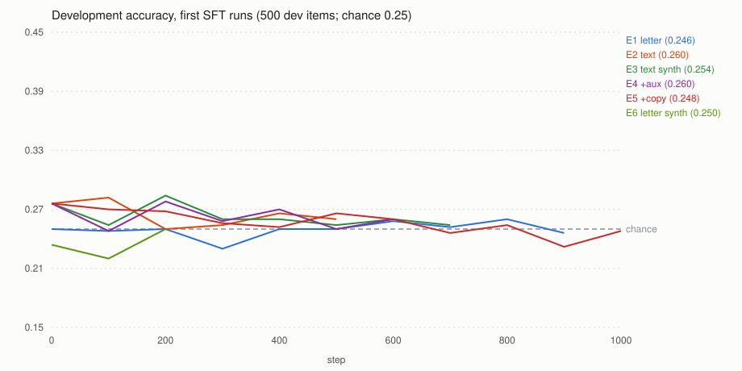
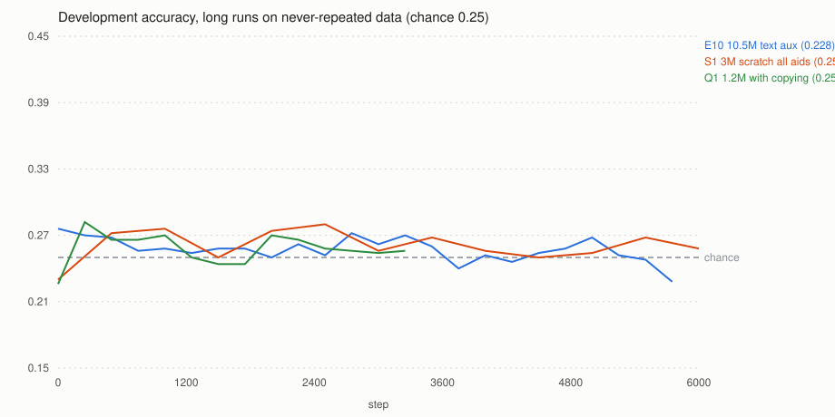
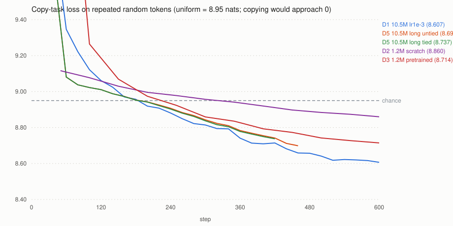

# AsemLLM Stage 2: supervised fine-tuning for passage QA (Common Lisp, CPU only)

**Result: the target was not reached, and no fine-tuned model has yet beaten chance.** Best development accuracy of any run
is 28.4% (142/500) against a 95% chance band that reaches 28.8%; the pretrained model itself scores 27.6% with the same scoring.
The locked 1,000-question test set was therefore **not** evaluated and remains unused.

The useful outcome of this stage is a diagnosis plus the infrastructure to act on it:

- **The Stage 1 models cannot copy anything from their context.** On a sequence of random tokens repeated twice, the 10.52M model's
  loss on the second copy equals its loss on the first (13.06 vs 13.09 nats). Every formulation of passage QA needs in-context
  copying or matching, so fine-tuning has nothing to build on, and the runs show exactly that: training-set accuracy rises when
  items repeat (memorization), dev accuracy stays at chance, and with never-repeated data both stay at chance.
- **Copying can be created, and quickly, but only with dense copy supervision.** QA fine-tuning variants (auxiliary prompt loss,
  high-entropy and never-repeated training items, a gated tied embedding path, relative-position attention biases, a 3M model from
  scratch) produced at most small copying signals. A dedicated copy-task stage did: the 1.16M model with relative-position biases
  and the tied path, trained on batches of 128 sequences of 40–63 random tokens repeated twice, went through a sharp transition
  between steps 400 and 600 and now predicts the second copy almost perfectly (0.018 nats, run C1).
- **Copying alone did not make that 1.16M model answer questions** (Q1: chance after 3,250 QA steps). The QA task also needs the
  question's entity bound to the right passage sentence. The same copy stage works on the 10.52M model (C2: 0.019 nats after 1,000 steps), but QA fine-tuning of that copying model,
  with associative-recall examples mixed in, also stayed at chance (Q2, 1,500 steps; Q3 for 1.16M, 4,000 steps).
- The benchmark, the answer-only SFT pipeline, the controls and the probes are built, tested and committed on `stage2-qa`.

## What was built

| Piece | Where | Tested by |
|---|---|---|
| QA benchmark generator (5 categories, held-out entities and wording, solver-checked keys) | `lisp/src/qagen.lisp`, `lisp/bin/qa-build.lisp` | `tests/test-qagen.lisp` |
| Locked test set (1,000) and dev set (500), SHA-256 lock, audit manifest | `lisp/eval/qa/` (see its README) | `tests/test-qagen.lisp` |
| Answer-only loss: output head and softmax computed only at answer rows | `forward-rows` / `backward-rows` in `lisp/src/tf.lisp` | `tests/test-tf.lisp` (finite differences, padding invariance, no gradient from masked positions, weighted rows) |
| SFT trainer: letter or text targets, padding buckets, data-parallel threads, gradient accumulation, AdamW, warmup + cosine, clipping, deterministic order, dev-selected best checkpoint, exact resume, shuffled-label control, auxiliary prompt loss, copy-task mixing | `lisp/src/sft.lisp` (FP32 derived: `sft32.lisp`), `lisp/bin/sft.lisp` | `tests/test-sft.lisp` (alignment, no truncation, fitting, bit-exact FP32 resume, FP32/FP64 agreement, dev selection, auxiliary loss, copy task, Wilson interval) |
| Evaluation with controls and 95% Wilson intervals; refuses the locked test file unless explicitly asked and logs every locked run | `lisp/bin/qa-eval.lisp` | used on dev |
| Optional gated tied copy path in the output head; optional learned relative-position attention biases (both exact no-ops when added to a checkpoint) | `lisp/src/tf.lisp` | `tests/test-tf.lisp` (no-op, gradients, BLAS = Lisp, converted models own their vectors) |
| In-context copying probe; dependency-free SVG charts | `lisp/bin/induction-probe.lisp`, `lisp/bin/qa-chart.lisp` | |

All 13 Lisp test files pass (the 11 from Stage 1 plus `test-qagen` and `test-sft`).

## Benchmark

See [`lisp/eval/qa/README.md`](../lisp/eval/qa/README.md). 1,000 locked test and 500 dev items, 200/100 per category (attribute
extraction, reverse lookup, directed relations, numeric comparison, temporal order). All four options appear in the passage equally
often; answer positions are exactly balanced; entities are split 3/1/1 with no overlap; every sentence and question frame belongs to
one split (3 of 97 test frames share a generic 4-word phrase with a training frame); no near-duplicates across splits. Every prompt
fits the 128-token window with the longest option (maximum 124 positions) and nothing is ever truncated. Each answer letter is one
token (` A` 316, ` B` 367, ` C` 338, ` D` 443) in its real context. The dev and test files rebuild byte for byte.

Shortcut baselines (test): one fixed letter 25.0%; first-mentioned option 25.3%; longest 26.7%; a lexical rule (option in the
passage sentence sharing the most words with the question) 59.1% (dev 62.0%).

## Pretrained baseline on dev (no fine-tuning)

| Scoring | Real prompt | No question | No passage | Question from another item | Counterfactual question | Options reversed |
|---|---|---|---|---|---|---|
| Letter (argmax of A–D logits) | 23.4% (117/500) [19.9, 27.3] | 23.6% | 23.8% | 25.2% | 25.8% | 24.4% |
| Text (option log-likelihood) | 27.6% (138/500) [23.8, 31.6] | 28.8% | 27.2% | 28.8% | 25.6% | 27.6% |

Removing the question or the passage changes nothing: the model does not use them. With letter scoring it picks a letter position,
not an option (after reversing the options it picks the same option only 1.6% of the time); text scoring is order-invariant (91.8%).
Files: `docs/results/stage2/dev-eval-pretrained-{letter,text}.json`.

## Experiments

Common settings: start from the Stage 1 10.52M checkpoint (`data/runs/final/10m/best.ckpt`, SHA-256 `10e6e08e…`) unless noted, FP32
with Accelerate, Adam(0.9, 0.95), clipping 1.0, dev evaluation every 100–500 steps. "Probe" = accuracy on 500 training items. At
500 dev items the 95% half-width is about ±4 points and the upper end of the chance band is 28.8%.

| Run | Change | Steps | Dev best / last | Probe (last) | What happened |
|---|---|---|---|---|---|
| E1 | letter target, 16k items, real-name pools, lr 3e-4, batch 32 | 900 | 26.0 / 24.6 | 25.2 | prediction collapses onto one letter, which changes between evals |
| E2 | text target (answer tokens), option-likelihood scoring | 500 | 28.2 / 26.0 | 31.0 | learns which strings are training answers; dev loss rises |
| E3 | training people/towns from ~4,000 generated names | 700 | 28.4 / 25.4 | 35.0 | same; probe above dev = memorization |
| E4 | + auxiliary next-token loss on the prompt (1.0) | 600 | 27.8 / 26.0 | 35.6 | first copying signal on the probe (gap 1.05 nats) |
| E5 | + 8,000 repeated-random-sequence copy examples | 1,000 | 27.6 / 24.8 | 36.4 | no change on dev |
| E6 | letter target with generated-name data, batch 64 | 200 | 25.0 / 25.0 | 26.8 | collapse onto one letter |
| E7 | letter, 32k items, aux 0.5, lr 5e-4 | 1,000 | 25.0 / 24.6 | 27.4 | collapse onto one letter |
| E8 | text + tied copy path + aux 0.5, 32k items | 1,250 | **invalid** | | gate vector was a dangling stack object (bug, fixed) |
| E9 | E8 on 256k never-repeated items | 1,500 | **invalid** | | same bug |
| E10 | text + aux 0.5 on 256k never-repeated items, lr 5e-4 | 5,750 | 27.6 / 22.8 | 31.8 | flat for 5,750 steps; stopped |
| S1 | 3M model **from scratch** + relative biases (K=8) + tied path + aux 1.0, fresh items, lr 1e-3 | 6,000 | 28.0 / 25.8 | 24.4 | opened the tied gate (-0.94), copy gap 3.4 nats, dev at chance; best checkpoint has no question conditioning (28.4% without the question) |
| Q1 | 1.16M model **after C1 copy training** (copies perfectly), text + aux 0.5 + copy examples, fresh items, lr 1e-3 | 3,250 | 28.2 / 25.6 | 23.0 | copying alone is not sufficient; stopped |
| Q3 | Q1 + 150k associative-recall examples mixed in | 4,000 | 26.6 / 25.0 | 26.0 | recall examples did not help the 1.16M model |
| Q2 | **10.52M after C2 copy training** + recall + copy examples, text + aux 0.5, fresh items, lr 5e-4 | 1,500 | 25.2 / 22.2 | 26.4 | at chance; temporal 14–19% (below chance: it appears to favour the place named in the question); stopped |

Runs were stopped early when they had shown no movement for several evaluations; their logs are complete up to that point
(`docs/results/stage2/runs/*.jsonl`, each with its exact arguments in the start event). The ones planned at 8,000 steps (E7, E8)
were stopped for the reasons in the table, not for time.

### Diagnosis: no in-context copying

`bin/induction-probe.lisp`: 30–50 sequences of 40 random tokens, each repeated twice; mean next-token loss on each copy.

| Checkpoint | First copy | Second copy |
|---|---|---|
| Stage 1 10.52M | 13.09 | 13.06 |
| Stage 1 1.16M | 13.66 | 13.69 |
| E3, 700 steps | 11.99 | 11.94 |
| E4, 600 steps (aux loss) | 14.47 | 13.42 |
| R1, 1.16M + relative biases, 600 copy steps | 9.45 | 8.95 |
| S1, 3M from scratch, 6,000 QA steps | 16.10 | 12.75 |
| **C1, 1.16M after 1,000 copy steps** | 36.17 | **0.018** |
| **C2, 10.52M after 1,000 copy steps** | 24.00 | **0.019** |

Direct copy training (loss on the second copy; chance 8.95 nats over the 7,700 token ids used, copying would approach 0):

| Run | Steps | Copy loss start → end |
|---|---|---|
| D1 10.52M, lr 1e-3, 8–30 tokens | 600 | 11.89 → 8.61 |
| D2 1.16M from scratch, lr 3e-3 | 600 | 9.12 → 8.86 |
| D3 1.16M pretrained, lr 3e-3 | 600 | 11.00 → 8.71 |
| R1 = D3 + relative-position biases (K=8) | 600 | 11.00 → 8.64 |
| D4 1.16M pretrained, frequent tokens only (chance 7.09) | 600 | 9.64 → 6.83 |
| D5 10.52M, 40–63-token copies, batch 64, untied / tied | ~440 | 11.87 → 8.70 / 8.74 |
| **C1 1.16M pretrained + relative biases + tied path, 40–63-token copies, batch 128, lr 3e-3** | 1,000 | **11.0 → 0.016** (8.96 at step 200, 7.00 at 400, 0.08 at 600) |
| **C2 10.52M, same recipe, lr 1e-3** | 1,000 | **11.9 → 0.013** (8.49 at 400, 5.12 at 500, 0.65 at 600, 0.09 at 700) |

A tiny model *does* learn to copy when the copied tokens come from a 60-token range (7.16 → 2.81 nats, chance 4.09), identically with
and without Accelerate, so the trainer and the attention kernels are not at fault. What fails is copying arbitrary tokens from an
8,192-token vocabulary within a few hundred steps. Two architectural reasons were tested: untied input/output embeddings (each
token's input→output association must be learned separately; remedy: gated tied path) and learned absolute positions (a previous-token
head must be assembled from 128 position vectors; remedy: relative-position biases). On their own each gave at most a small improvement. Combined with dense copy supervision (C1: batch 128 of 40–63-token
repeats, about 6,500 copy targets per step, against about 600 in D1–D3) the 1.16M model learned to copy in roughly 500 steps;
which of the three ingredients is necessary was not separated (one ablation per ingredient is the obvious next measurement).

### Bug found and fixed during the night

`ADD-TIE-GATE` built the new parameter vector with `(concatenate 'simple-vector ... (vector NEW-ARRAY))`. SBCL 2.6 allocated
`NEW-ARRAY` on the stack, so the converted model held a pointer into a dead stack frame, shared by every model converted in the
process. A test caught it (two converted models shared their gate); the converters now build the vector with `make-array` + `replace`,
and a regression test checks that converted models own their vectors across a full GC. Runs E8 and E9 used the broken converter and are
excluded.

## Locked test set

Not evaluated. `bin/qa-eval.lisp` refuses `lisp/eval/qa/test.jsonl` unless `locked-test=1` is passed and the file's SHA-256 matches
`test.lock`, and appends every such run to `docs/results/stage2/locked-test-runs.jsonl`. That file does not exist: the test set has
never been scored. Spending it on a model at chance on dev would add no information.

## Corpus for additional pretraining (Phase 8)

The existing reproducible pipeline is fetching FineWeb-Edu `sample/10BT` shards `000`–`013` (same filters as Stage 1: edu score >= 4.0,
language score >= 0.95) into `data/fineweb/stage2.jsonl` at the lowest CPU priority, with a 45M FineWeb-token target (about 50M tokens
with the 8,192 BPE, from the Stage 1 ratio). It is network-bound (about 2,000 tokens/s) and resumable (`resume=1`, progress file
`stage2.jsonl.progress`). At the time of writing: **20.4M FineWeb tokens, 18,855 documents, 102 MB, shards 000–003 read** (about
45% of the target). Not yet built into shards: `bin/build-data.lisp` (dedup, split, BPE, manifest with SHA-256) needs 8 GB and all
cores and was deferred so it would not compete with QA training. Whether more pretraining improves QA was not tested, as
planned; the copy results above suggest it would mainly matter through in-context abilities, which the probe can measure first.

    nice -n 19 sbcl --dynamic-space-size 4GB --script lisp/bin/fetch-fineweb.lisp data/fineweb/stage2.jsonl max-tokens=45000000 \
         shards=sample/10BT/000_00000.parquet,...,sample/10BT/013_00000.parquet resume=1
    sbcl --dynamic-space-size 8GB --script lisp/bin/build-data.lisp build data/fineweb/stage2.jsonl data/fineweb/stage2 8192 100000 4.0 10 10

## Speed and memory

Answer-only SFT of the 10.52M model on 8 threads: about 5,500 prompt tokens/s (median, E1–E3); 4,300–4,700 with the auxiliary loss,
which computes the full output head. Peak RSS 0.56–1.9 GB depending on how many padding buckets are live and on the training set
held in memory (256k items). Dev evaluation: about 5 s (letter) or 20 s (text: four forward passes per item).

## Recommendation for the next milestone

1. **Make copying a gated prerequisite.** Every QA fine-tuning run should start from a checkpoint whose induction probe shows a
   second-copy loss far below the first (C1: 0.018 vs 36). The C1 recipe does this in about 10 minutes for 1.16M and about 50 minutes for 10.52M (C2).
   Ablate the recipe (batch size, relative biases, tied path) on 1.16M first: each point costs about 10 minutes.
2. **Then teach binding as its own stage, with its own probe.** Copying models still fail the QA task (Q1, Q2), and mixing
   paraphrased associative-recall examples into QA fine-tuning did not help within 1,500–4,000 steps (Q2, Q3). Next: train recall
   alone (dense: many queries per sequence, loss only on the recalled values) until a held-out recall probe with unseen names is
   solved, exactly as the copy stage was gated on the induction probe, and only then run QA fine-tuning. The below-chance temporal
   score in Q2 (it picks the place named in the question) is a concrete failure mode to watch for: copying without binding.
3. **Keep the QA fine-tuning setup that is now clean:** text targets with option-likelihood scoring, never-repeated high-entropy
   training items, auxiliary prompt loss, dev-selected checkpoints, shuffled-label control, full control evaluation. Attempt the
   letter format only after text scoring works.
4. **Do not scale the model or the QA data yet.** Neither addresses the missing mechanisms: 256k never-repeated items and a 3M
   model from scratch both stayed at chance.
5. **Keep the locked test set locked** until a checkpoint is clearly above the dev chance band (more than 30% on 500 items) and
   passes the question and passage controls.

## Reproduce

    sbcl --dynamic-space-size 4GB --script lisp/bin/qa-build.lisp data=data/fineweb/stage1 out=data/qa/v1
    sbcl --dynamic-space-size 8GB --script lisp/bin/qa-build.lisp data=data/fineweb/stage1 out=data/qa/v3-synth-256k train-entities=synthetic train=256000
    TLM_BLAS=1 sbcl --dynamic-space-size 10GB --script lisp/bin/sft.lisp data=data/fineweb/stage1 qa=data/qa/v3-synth-256k \
         out=data/runs/sft/e10 mode=text aux-lm=0.5 steps=8000 batch=32 workers=6 lr=5e-4 warmup=200 eval-every=250
    TLM_BLAS=1 sbcl --dynamic-space-size 8GB --script lisp/bin/qa-eval.lisp data=data/fineweb/stage1 ckpt=CKPT \
         items=lisp/eval/qa/dev.jsonl mode=text out=dev-eval.json
    sbcl --dynamic-space-size 4GB --script lisp/bin/induction-probe.lisp ckpt=data/runs/final/10m/best.ckpt

Data hashes: v1 train `d4506b64…`, v2-synth train `585e3201…`, v3-synth-256k train `8e0b724f…`; dev `2d92c882…` and locked test
`8f756bcd…` are identical in all three. Run logs with exact arguments: `docs/results/stage2/runs/`.
